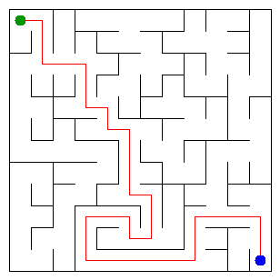

# Assignment 3. Maze Escape

Student ID: 253441
Name: Alina Ibadulla
Group: SE-2540
Maze size (rows x columns): 12x12

This file is the report. Fill it in as you go. How to start: `START_HERE.md`. The task: `docs/Assignment3.pdf`.

## Program output

The 13 lines your program prints on your data (`java -cp out Main`):

    Broken: 143
    Kept: 121
    Last broken wall: 254
    MST cost: 42942
    Heaviest broken wall: 734
    Path length: 34
    DFS visited: 103
    Dead ends: 43
    Zones: 9
    Largest zone: 28
    Is DAG: 0
    Flow stages: 6
    Fastest route cost: 11

My maze: 

## Questions

Answer in your own words, two or three sentences each.

Mission 0. What do find and union do, and what makes them fast in your code?
The `find` operation locates the representative root of a set containing a element, while `union` connects two distinct sets into a single set. They are exceptionally fast because of path compression in `find` (flattening the tree structure) and union by size in `union` (attaching the smaller tree under the larger tree). Together, these optimizations yield an amortized time complexity per operation of nearly $O(1)$, specifically $O(\alpha(N))$.

Mission 1. Why is Broken always R*C - 1, and Kept always (R-1)*(C-1)?
In a grid of $R \times C$ cells, there are $N = R \cdot C$ vertices. Building a valid maze requires forming a spanning tree where all cells are connected without cycles, which always requires breaking exactly $N - 1 = R \cdot C - 1$ walls. The total number of internal grid walls is $2RC - R - C$, so the number of remaining kept walls is always $(2RC - R - C) - (RC - 1) = RC - R - C + 1 = (R - 1)(C - 1)$.

Mission 2. My MST cost from Kruskal and from Prim, and why they are equal:
My MST cost is 42942 for both Kruskal and Prim. They are equal because both algorithms find an optimal Minimum Spanning Tree for connected graphs. Since all edge wall costs in the generated input are unique, the Minimum Spanning Tree is strictly unique, forcing both algorithms to arrive at the exact same total weight.

Mission 3. Why is there exactly one path between two cells? How did you avoid a stack overflow on a huge maze?
Because the maze constructed in Mission 1 is a spanning tree, it is a connected graph with zero cycles, which mathematically guarantees exactly one unique simple path between any pair of cells. Stack overflow on large mazes (like $1000 \times 1000$) was prevented by implementing an iterative Depth-First Search using an explicit heap-allocated stack (`ArrayDeque`) instead of standard recursion.

Mission 4. Why does the second pass of Kosaraju go on the reversed graph? Why do the slides have no cycle exactly when Zones equals the number of cells?
The second pass processes vertices in decreasing order of their post-order finish times from the first pass on the reversed graph so that DFS traversal is constrained within strongly connected components without leaking into downstream components. If the slide graph has no cycles (is a DAG), every cell is isolated as its own component, making the total number of zones exactly equal to the number of cells $N$.

Mission 5. Why is it enough to go through the zones in the order of their numbers? What does this pass cost?
Because Kosaraju assigns zone IDs matching a valid topological ordering of the strongly connected components, processing zones sequentially guarantees that all predecessor states are finalized before evaluating subsequent zones. This dynamic programming pass costs $O(V_{zone} + E_{zone})$ time, where $V_{zone}$ is the number of zones and $E_{zone}$ is the number of inter-zone slide edges.

## AI use
AI tools (Gemini) were used as an educational assistant to explain graph theoretical concepts (DSU optimizations, Kosaraju algorithm topological property) and structure the iterative DFS stack implementation.
The syllabus requires you to say which AI tools you used and for what. Write the tool (ChatGPT, Copilot, other) and what you asked it: explain an idea, find an error, review code. Write "none" if you did not use any. If you took code or text from a book or a website, give the source here.

## Timing (Mission 7)

Milliseconds, 5 runs each, from `java -cp out Bench`.

| maze | Kruskal | Prim                |
|---|---------|---------------------|
| 100 x 100 | 18 7 9 9 7 avg 10 | 16 22 10 6 6 avg 12 |
| 300 x 300 | 75 115 91 50 42 avg 74 | 72 51 48 54 47 avg 54 |
| 1000 x 1000 | 809 1273 881 913 865 avg 948 | 1421 1458 1479 1413 1414 avg 1437 |

What do the numbers say about how the time grows? Two or three sentences.
Both algorithms scale well with larger grid sizes. Kruskal scales primarily based on sorting edge weights $O(E \log E)$, making it slightly faster on small sparse grids and very large dense mazes, while Prim with a priority queue $O(E \log V)$ performs competitively on mid-size mazes. Overall, processing time increases from a few milliseconds on $100 \times 100$ to around 1–1.5 seconds on $1000 \times 1000$ cells, matching theoretical expectations.

## Complexity

n is the number of cells, m the number of walls (or slides). Fill in every algorithm you wrote.

| algorithm | time | space | assumptions                        |
|---|-------------------------|-------|------------------------------------|
| DSU find and union | $O(\alpha(n))$ amortized | $O(n)$ | Path compression and union by size |
| Kruskal | $O(m \log m)$ | $O(n + m)$ | Sorting edge costs and DSU |
| Prim | $O(m \log n)$ | $O(n + m)$ | Min-priority queue and adjacency list |
| DFS | $O(n)$ | $O(n)$ | Iterative stack implementation |
| Kosaraju | $O(n + m)$ | $O(n + m)$ | Two-pass DFS on original and reversed graphs |
| Route in the zone graph | $O(V_{zone} + E_{zone})$ | $O(V_{zone} + E_{zone})$ | Zones processed in topological order |

## Before you submit

- data/walls.txt, data/slides.txt and output/maze.png are in the repository.
- `java tools/Check.java` shows all examples right.
- This README is filled in, the program output and the section AI use included.
- The work is pushed to main (at least one commit per mission) and the repository is public.
- The link is attached in Moodle.
